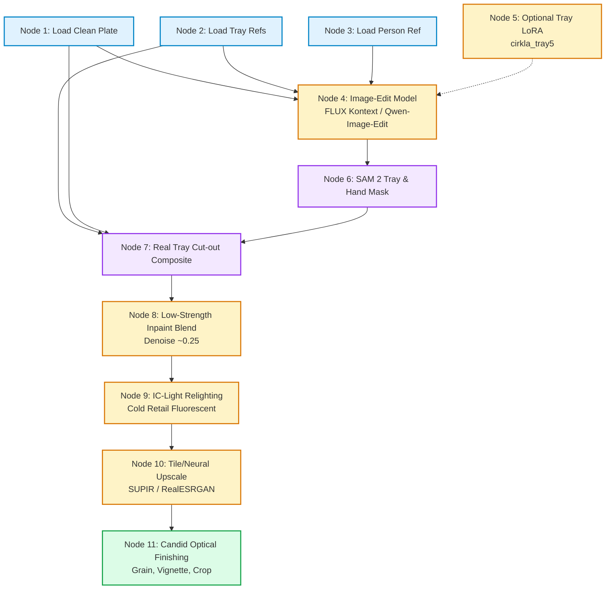

# ComfyUI Production Pipeline Architecture (Phase 2)

> **Specification Note**: This document outlines the node-by-node architecture for local ComfyUI inference in Phase 2. No models have been trained or deployed yet; this specifies the planned pipeline.

---

## 1. Pipeline Overview & Node-by-Node Description

The Phase 2 ComfyUI workflow combines diffusion image editing, specialized geometric priors (LoRA), precise structural segmentation, photorealistic compositing, neural relighting, and candid smartphone optical finishing.

---

### Node 1: Load Clean Plate
- **Type**: `LoadImage`
- **Input**: Photographic plate asset from `assets/plates/` (e.g., `Trader Joe's Shelf.jpeg` or `Meat Aisle Background.png`).
- **Function**: Establishes background context, supermarket shelving, price tag geometry, and initial aspect ratio (typically 3:4 portrait or 4:5 mobile aspect ratio).
- **Compute**: **CPU only** (I/O).

### Node 2: Load Tray References
- **Type**: `LoadImage` / `ImageBatch`
- **Input**: 2–3 canonical multi-angle reference photos from `assets/trays/` (three-quarter angle, top-down planar view, and corner pyramid detail).
- **Function**: Feeds visual tokens into the multi-reference cross-attention layers of the image-edit backbone.
- **Compute**: **CPU only** (I/O).

### Node 3: Load Person Reference
- **Type**: `LoadImage` (Optional depending on shot type)
- **Input**: Reference shopper photo from `assets/persons/` (e.g., hands with natural skin texture, sleeve jacket color, torso framing).
- **Function**: Conditions shopper identity, natural skin undertones, hand anatomy, and clothing texture.
- **Compute**: **CPU only** (I/O).

### Node 4: Image-Edit Diffusion Backbone
- **Type**: `UNETLoader` / `DiffusionModelLoader` (`FLUX.1-Kontext` or `Qwen-Image-Edit`)
- **Conditioning**: Dual text prompts (positive short prompt + expanded product grounding) and latent concatenation of image references.
- **Function**: Generates the coherent candidate scene synthesizing shopper, retail cooler aisle, and tray in the requested perspective (`front_chest`, `pov_hands`, `side_profile`, etc.).
- **Compute**: **High-VRAM GPU Required** (16 GB–24 GB VRAM; bfloat16 / fp8 quantized).

### Node 5: Optional Tray LoRA (`cirkla_tray5`)
- **Type**: `LoraLoader`
- **Weights**: `cirkla_tray5.safetensors` (strength: `0.75 - 0.90`)
- **Function**: Injects trained geometric weights for Cirkla-specific features (10.28"x8.08" #5 size, vertical scalloped sidewall fluting, corner reinforcement pyramids, and beige unbleached molded plant fiber texture).
- **Compute**: **GPU Required** (Injected directly into transformer cross-attention matrices).

### Node 6: SAM 2 Tray & Hand Segmentation Mask
- **Type**: `SegmentAnything2_GroundingDINO`
- **Prompt**: `"molded fiber tray, human hands holding package"`
- **Function**: Produces crisp pixel-level masks separating the tray body, plastic film perimeter, and occluding fingers.
- **Compute**: **GPU Required** (4 GB–8 GB VRAM; fast tensor evaluation).

### Node 7: Composite Real Tray Cut-out
- **Type**: `ImageCompositeMasked`
- **Inputs**: Raw generated candidate + high-resolution clean tray cut-out (`assets/trays/*_clean.png`) + SAM 2 mask.
- **Function**: Pastes exact photographic tray rim fluting, corner pyramids, and authentic paper sleeve typography onto the generated geometry to eliminate AI lettering hallucination.
- **Compute**: **CPU only** (NumPy / PIL alpha composite).

### Node 8: Low-Strength Inpaint Blend
- **Type**: `KSampler (Inpainting)`
- **Denoise**: `0.22 - 0.32` (low strength)
- **Mask**: Dilated seam mask (`5-10px`) around the perimeter of the composited cutout and human fingers.
- **Function**: Seamlessly blends edge transitions, casts micro contact shadows from shopper thumbs onto the rim flange, and fuses packaging reflections into the hand grip.
- **Compute**: **GPU Required** (Intermediate VRAM).

### Node 9: IC-Light Relighting
- **Type**: `ICLightConditioning` / `ICLightModel`
- **Input**: Cold retail supermarket lighting map (overhead fluorescent strip tubes + refrigerated LED case lighting from below/sides).
- **Function**: Eliminates artificial studio highlights by casting coherent directional illumination, taut MAP clear barrier film specular flares, and ambient cold store bounce across tray and hands.
- **Compute**: **GPU Required** (8 GB–12 GB VRAM).

### Node 10: Neural Latent / Tiled Upscaler
- **Type**: `SUPIR_Upscale` or `UltimateSDUpscale` (model: `4x_NMKD-Superscale-SP_178000_G`)
- **Scale Factor**: 1.5x–2.0x (Target: ~2048 x 2730 px)
- **Function**: Sharpens fine fiber texture, micro-pores in pulp, raw beef marbling, and crisp sleeve barcode lines without introducing artificial smoothness.
- **Compute**: **GPU Required** (Tile-based memory management).

### Node 11: Candid Smartphone Optical Finishing
- **Type**: `CustomPostProcess` (incorporating `src/finish.py`)
- **Operations**:
  - Grain synthesis (sensor ISO 400 noise)
  - Subtle lens chromatic aberration (radial shift 0.15)
  - Handheld mobile tilt (1.0°–1.5°)
  - Off-center supermarket crop and JPEG compression (quality 85)
- **Provenance**: Injects EXIF/PNG chunks: `Comment: AI-generated mockup`.
- **Compute**: **CPU only** (Fast vectorized NumPy operations).

---

## 2. Hardware & GPU Allocation Matrix

| Pipeline Step | ComfyUI Node | Engine / Module | Hardware Requirement | Min VRAM |
| :--- | :--- | :--- | :---: | :---: |
| 1. Plate Load | `LoadImage` | Pillow / Torch I/O | **CPU** | N/A |
| 2. Tray Refs Load | `LoadImage` | Pillow / Torch I/O | **CPU** | N/A |
| 3. Person Ref Load | `LoadImage` | Pillow / Torch I/O | **CPU** | N/A |
| 4. Scene Edit | `FLUX / Qwen Loader` | Transformer Diffusion | **GPU (Heavy)** | 16–24 GB |
| 5. Tray LoRA | `LoraLoader` | Peft / SafeTensors | **GPU** | Shares with Node 4 |
| 6. Segmentation | `SAM 2 / Grounding` | SAM 2 ViT | **GPU (Moderate)** | 6–8 GB |
| 7. Real Tray Cut-out | `ImageComposite` | PIL Alpha Composite | **CPU** | N/A |
| 8. Edge Inpainting | `KSampler` | SDXL / FLUX Inpaint | **GPU (Moderate)** | 10–14 GB |
| 9. Neural Relighting | `IC-Light` | IC-Light UNet | **GPU (Moderate)** | 8–12 GB |
| 10. Upscaling | `UltimateSDUpscale` | Tile Diffusion | **GPU (Moderate)** | 8–12 GB |
| 11. Optical Finishing | `Finisher` (`src.finish`) | NumPy / OpenCV | **CPU** | N/A |

### Recommended Local System Specification
- **GPU**: NVIDIA RTX 3090 / 4090 (24 GB VRAM) or A5000 / A6000.
- **System RAM**: 32 GB DDR4/DDR5 minimum (64 GB recommended for model offloading).
- **Storage**: Fast NVMe SSD (at least 60 GB free for checkpoints, VAE, SAM 2, and LoRA weights).
